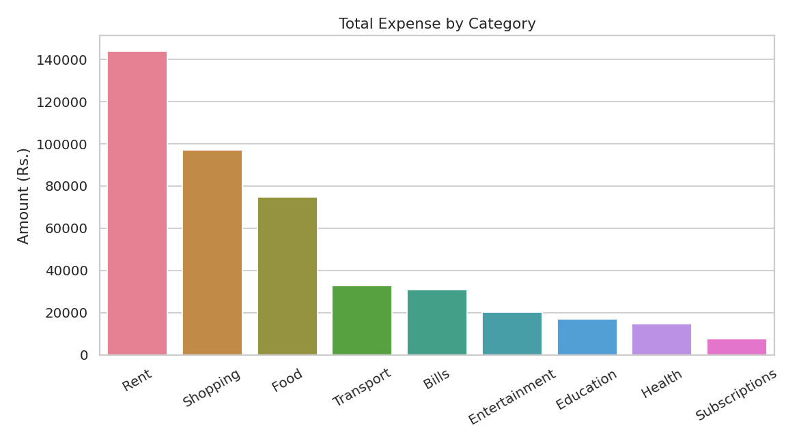
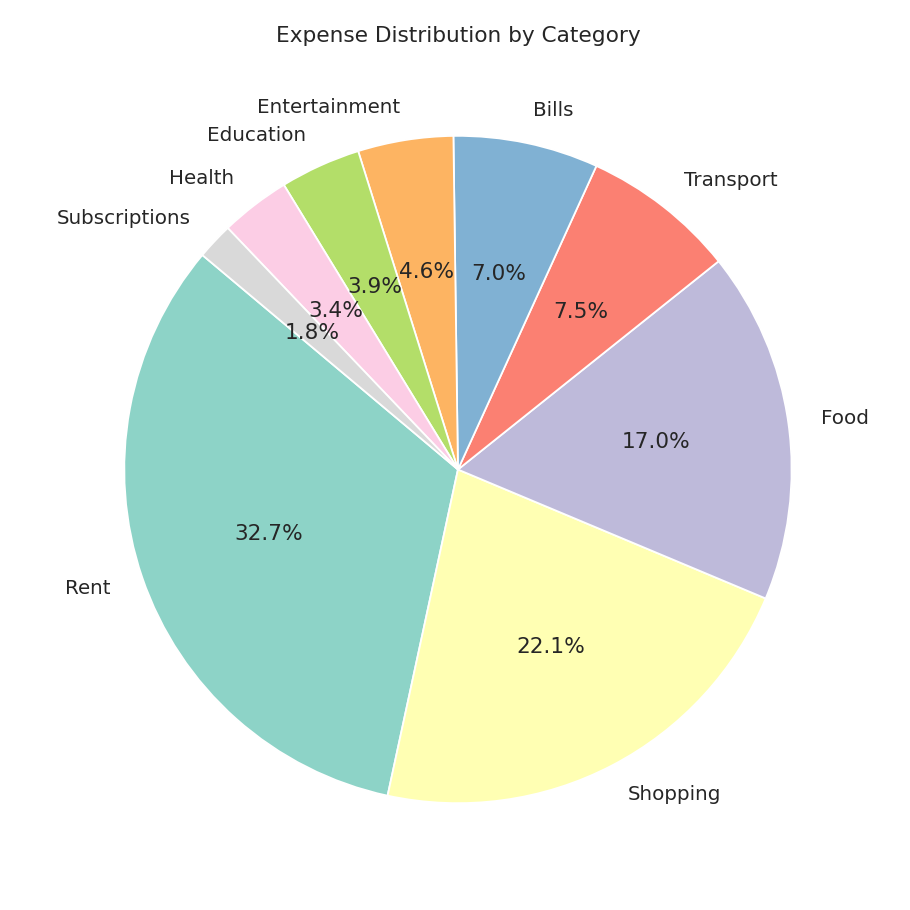
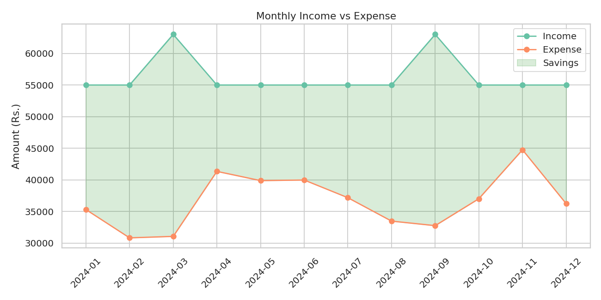
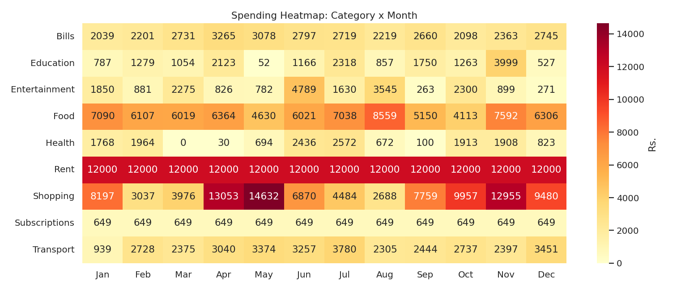
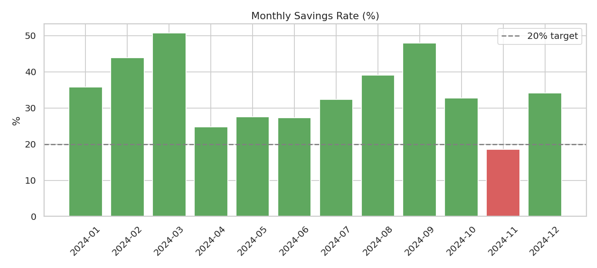
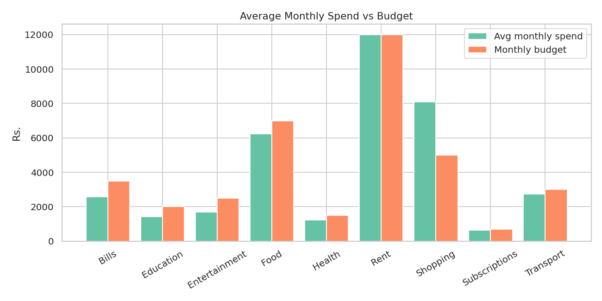

# 💰 Expense Tracker App using Data Science

An end-to-end, beginner-friendly data science project that **generates synthetic expense data, cleans it, analyses spending behaviour, detects overspending, visualises trends and serves everything in an interactive Streamlit dashboard.**

Built for **Data Analyst / Business Analyst / Financial Analyst** portfolios.

## 📌 Problem
People and businesses record transactions but rarely understand them. Raw logs don't answer: *Where does my money go? Which month did I overspend? Am I saving enough?*

## ✅ Solution
A pipeline that turns raw transactions into **category summaries, monthly trends, budget alerts, anomaly detection and plain-English insights**.

```
Data input → Cleaning → Feature engineering → Analysis → Visualisation → Insights → Decisions
```

## ✨ Features
- Synthetic 12-month dataset (income, rent, bills, daily spend, seasonal spikes, deliberately dirty rows)
- Data cleaning (duplicates, casing/whitespace, bad dates, missing amounts)
- Feature engineering (month, weekday, weekend flag, savings rate)
- Category, monthly, weekday and payment-method analysis
- **Overspending detection** against per-category budgets
- **Anomaly detection** (z-score on unusually large transactions)
- Auto-generated insights report
- 8 charts + interactive Streamlit dashboard (filters, CSV upload, download)

## 🛠 Tech Stack
Python · Pandas · NumPy · Matplotlib · Seaborn · Streamlit

## 📂 Structure
```
Expense-Tracker-App/
├── data/        expenses.csv (raw), cleaned_expenses.csv
├── notebooks/   exploratory notebooks (optional)
├── src/         data_generator.py, cleaning.py, analysis.py, visualization.py
├── outputs/     summaries, alerts, insights_report.txt
├── images/      generated charts
├── docs/        GUIDE.md (full walkthrough + interview prep)
├── app.py       Streamlit dashboard
├── main.py      runs the full pipeline
└── requirements.txt
```

## 🚀 How to Run
```bash
python -m venv venv
source venv/bin/activate        # Windows: venv\Scripts\activate
pip install -r requirements.txt
python main.py                  # pipeline + charts + insights
streamlit run app.py            # dashboard at http://localhost:8501
```

## 📊 Results (synthetic data, seed 42)
- Income ₹6,76,000 vs expenses ₹4,39,973 → **34.9% savings rate**
- Rent is the largest category (32.7%); **Shopping** is the largest *controllable* category (22.1%)
- Budgets exceeded **28 times**; Shopping is the repeat offender (8 months)
- November is the highest-spend month (festive shopping) with the lowest savings rate (18.6%)

## 🖼 Screenshots
| | |
|---|---|
|  |  |
|  |  |
|  |  |

Add a dashboard screenshot as `images/dashboard.png` after running Streamlit.

## 🔮 Future Improvements
Real bank-statement import · ML spending forecast · budget alert emails · goal tracking · mobile app · ESP32 button-based logging

## 📄 License
MIT
